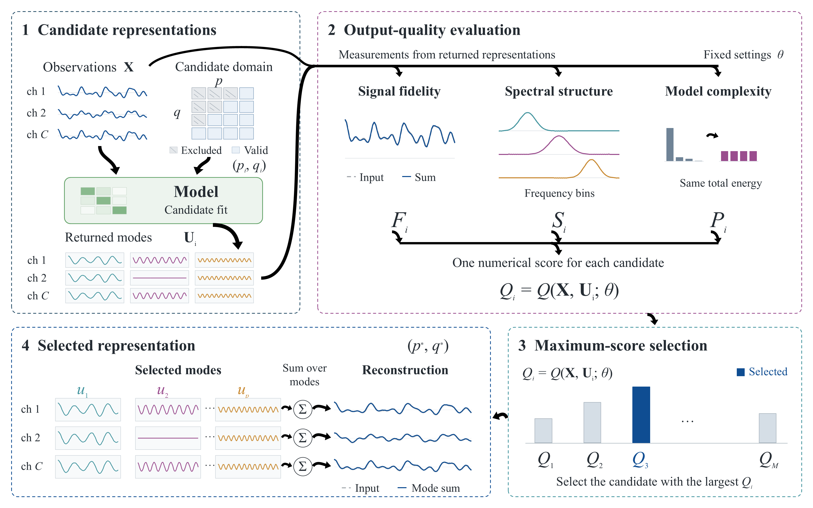
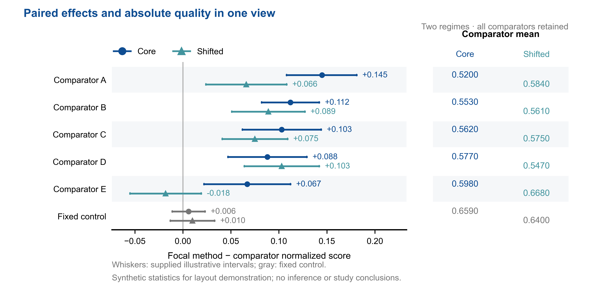

# Research Figure Skills · 科研论文图件

两套可复用 Agent Skills，来自作者反复审阅、修改后认可的科研图件制作方式。规则包含版块逻辑、科学对象表达、配色、图例、信息密度、证据检查、可编辑源文件及论文图件集成。它们适用于支持 `SKILL.md` 的 Codex/Cursor 等工具。

## 两个 skill

| Skill | 用途 | 核心表现方式 |
|---|---|---|
| [paper-method-flowchart](skills/paper-method-flowchart/SKILL.md) | 方法流程图、方法框架图 | 科学对象、三层双输入布局、彩色虚线功能区、黑色实心弯箭头、统一数学标签 |
| [paper-experiment-visualization](skills/paper-experiment-visualization/SKILL.md) | 实验图、结果可视化 | 共享坐标、效应与区间、对齐数值列、机制和质量—成本融合布局 |

方法图使用 Times New Roman；实验图使用 Arial/Helvetica/DejaVu Sans。两个 skill 的规则与参考分开保存。新任务的科学内容必须以当前作者材料为准。

### 方法图示例



示例采用顺时针功能分区。左上模块把两路输入并列在顶部，核心操作居中，返回模态在底部按 ch 对齐；右上模块并列评价，再汇成一个分数。黑色实心弯箭头为可编辑的闭合自由形状，交界处平滑汇合。`ch 1`、`ch 2`、`ch C` 共用字号和基线，变量和上下标按数学层级排版。

可下载 [PPTX](skills/paper-method-flowchart/assets/demo/method-demo.pptx) 与 [PDF](skills/paper-method-flowchart/assets/demo/method-demo.pdf)。四个模块与波形、成员矩阵、评分均用于演示画法，具体方法以作者材料为准。

### 实验图示例



用一个效应坐标融合两个数据集、全部对照、完整区间与绝对均值列。保留跨零区间及负效应。示例统计表为合成数据，不用于研究结论。

实验 skill 另有六类 [布局配方](skills/paper-experiment-visualization/references/layout-recipes.md)：效应森林图、条件热表、质量—成本平面、参数景观与归因、真实信号结构、搜索成本与实测验证。可直接执行的助手目前为共享效应图，其余布局由 agent 根据数据和配方实现。

## 安装与调用

将 `skills/` 下各文件夹放进你的 Agent Skills 目录，例如 Codex 的 `~/.codex/skills/` 或 Cursor 的 `~/.cursor/skills/`；保留各自的 `SKILL.md`、references、scripts、agents 和 assets。也可用支持 GitHub 路径的 skill installer 安装对应子目录。

下次直接说：

> 使用 $paper-method-flowchart，根据我的论文方法和参考图，按认可标准绘制可编辑流程图。

> 使用 $paper-experiment-visualization，根据这些冻结统计重构实验图，把方法差异、区间和机制信息融合起来。

本地安装可以附加作者自己的认可成品。方法图放 `assets/approved-reference.png` / `.pptx`；实验图放 `assets/approved/`。这些本地参考优先于通用示例。此公开仓库只提供通用规则、示例数据与原创辅助代码，作者论文成品保存在其本地安装。

## 运行示例

Python 环境安装实验绘图依赖：

```sh
python -m pip install -r requirements.txt
python skills/paper-experiment-visualization/scripts/render_effect_comparison.py --csv skills/paper-experiment-visualization/assets/examples/effect_comparison.csv --meta skills/paper-experiment-visualization/assets/examples/effect_metadata.json --out output/effect-demo
```

输出固定画幅的 PDF、SVG、600 dpi PNG 和 JSON，记录数据、字体、物理尺寸、文本边界与来源/导出哈希。换成真实统计时修改 CSV 与 metadata 中的单位、区间含义、标题和来源；脚本不估计新统计。

安装 Node.js 依赖，并使用 Python 3 生成原生 PPT 示例：

```sh
npm install
node skills/paper-method-flowchart/scripts/build_method_demo.cjs --out output/method-demo.pptx
```

可用 `--python /path/to/python` 指定 Python。弯箭头助手仅使用 Python 标准库，也可独立为现有 PPTX 添加箭头和功能分组，见 [接口与路径示例](skills/paper-method-flowchart/references/curved-arrows.md)。

检查路径方向、几何输入、功能分组和原文件保留：

```sh
python skills/paper-method-flowchart/scripts/test_curved_arrows.py -v
```

Windows 安装有 PowerPoint 时可原生导出：

```powershell
powershell -NoProfile -File skills/paper-method-flowchart/scripts/export_ppt_pdf.ps1 -Source "output/method-demo.pptx" -Destination "output/rendered"
```

导出助手只读打开源文件并校验源哈希，输出 PDF、逐页 PNG 和记录。其他系统可用环境中已有渲染工具，但需核对字体、数学与箭头。自动文字边界检查不能替代视觉与科学内容 QA。

## 设计原则

- 每个功能先有输入—操作—输出关系，再有图形与边框。
- 方法图主要由有科学语义的抽象图形解释过程，数值示例只占少部分。
- 实验图先回答科学问题，再选共享坐标或紧凑分区；融合不等于删除一切子图。
- 优势由数据决定，负结果、控制、区间和代价不能被图形隐藏。
- 用户最新手改成品优先于旧脚本、旧 SVG 与旧导出。
- 成品要保留编辑源、代码、数据来源和导出验证。

视觉偏好吸收作者使用的 figures4papers 配色与审阅经验；本包脚本独立编写。MIT 许可证见 [LICENSE](LICENSE)。
